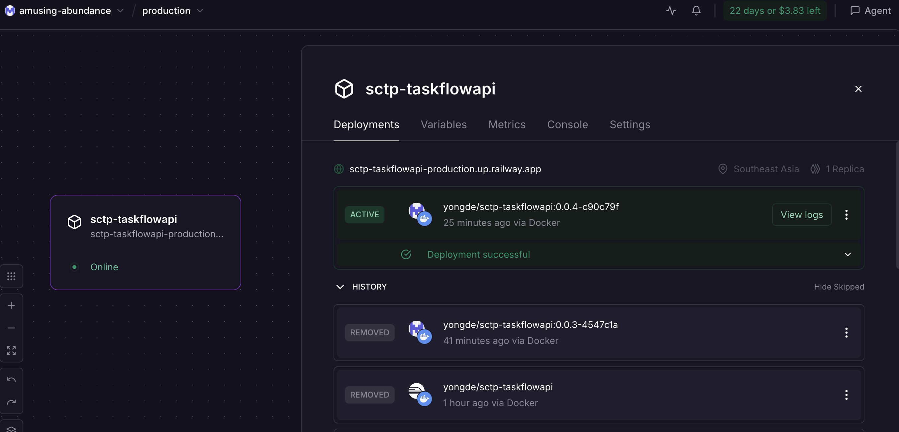
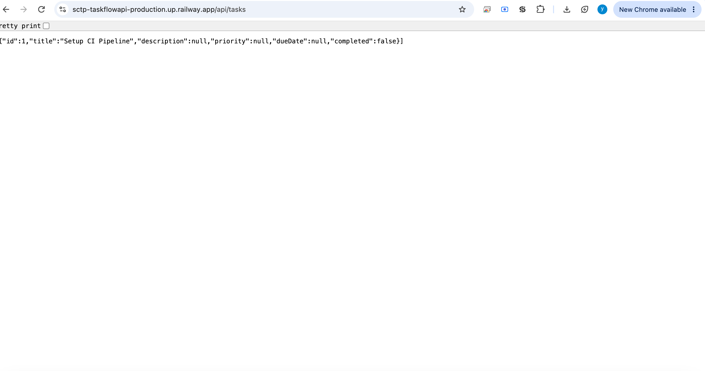

# TaskFlow API

A simple task management REST API built with Spring Boot. This is the sample project for the **Module 4 - End of Module Assignment**. Refer to the assignment instructions in **NTULearn** for the full list of tasks.

## Assignment submission

> [!IMPORTANT]
> **Submit your GitHub repository link to NTULearn.** This is the only thing you submit there - your live URL, screenshots and notes all go in this `README.md`.

Fill in each section below, then commit and push this `README.md` to your GitHub repository.

### Live application URL

Your TaskFlow API deployed on Railway:

```
https://sctp-taskflowapi-production.up.railway.app/api/tasks
```

### Screenshot: Railway dashboard

Your Railway dashboard showing the active deployment. Save the image in the `screenshots/` folder and update the file name below if needed.



### Screenshot: Live application

Your live Railway URL returning task data (in your browser or terminal).



### Errors and failures

If you didn't complete every task, list what you completed, what went wrong, and the error messages you saw. If everything worked, write "None".

```
None
```

### Stretch goal (optional)

Which stretch goal you chose (if any), what you built, and any links (for example, your frontend URL, CI pipeline run or Docker Hub tags).

**Option 1 – CI Pipeline (GitHub Actions)**

Every push to `main` triggers a pipeline that builds, tests, and publishes the Docker image to Docker Hub.

- Successful pipeline run: https://github.com/yongde01/sctp-taskflow-api/actions
- Docker Hub image: https://hub.docker.com/r/yongde/sctp-taskflowapi

**Option 2 – Frontend on Netlify**

A static HTML/JS client deployed to Netlify that calls the Railway API to list, create, and look up tasks. CORS is configured in Spring Security (`SecurityConfig.java`) to allow requests from the Netlify domain.

- Netlify frontend URL: https://steady-speculoos-a567c4.netlify.app

**Option 4 – Versioned Docker Images**

Images are tagged with `MAJOR.MINOR.PATCH-<short SHA>` (e.g. `0.0.3-4547c1a`) generated automatically in CI from the `pom.xml` version and the Git commit SHA. The CI pipeline pushes the versioned tag to Docker Hub and then deploys it to Railway via the Railway GraphQL API.

- Docker Hub tags: https://hub.docker.com/r/yongde/sctp-taskflowapi/tags

**Option 5 – Security Checks**

Security scanning runs as a dedicated `security` job in CI before the image is published:

- **Snyk** scans Maven dependencies and the built Docker image for HIGH/CRITICAL CVEs
- **CodeQL** performs static analysis (SAST) on the Java source code
- Results are uploaded to the GitHub Security tab as SARIF reports
- No secrets are committed to the repository; all credentials (Docker Hub, Railway, Snyk) are stored as GitHub Actions secrets

## Getting started

### Prerequisites

- Java 21
- Maven (or use the included Maven Wrapper)

### Running the Application

From the project root:

```bash
./mvnw spring-boot:run
```

On Windows:

```bash
mvnw.cmd spring-boot:run
```

The application starts on `http://localhost:8080`.

### API Routes

| Method | Path              | Description             | Request Body | Success Response |
|--------|-------------------|--------------------------|---------------|-------------------|
| GET    | `/api/tasks`      | Get all tasks            | —             | `200 OK`          |
| GET    | `/api/tasks/{id}` | Get a single task by ID  | —             | `200 OK`          |
| POST   | `/api/tasks`      | Create a new task        | Task JSON     | `201 Created`     |

### Testing the API

Create a task:

```bash
curl -X POST http://localhost:8080/api/tasks \
  -H "Content-Type: application/json" \
  -d '{
    "title": "Complete Module 3",
    "description": "Finish assignment",
    "priority": "HIGH",
    "dueDate": "2026-05-20",
    "completed": false
  }'
```

Get all tasks:

```bash
curl http://localhost:8080/api/tasks
```

Get a task by ID:

```bash
curl http://localhost:8080/api/tasks/1
```

### H2 Database Console

While the app is running, the H2 console is available at `http://localhost:8080/h2-console`.

Use the following connection settings:

- JDBC URL: `jdbc:h2:mem:taskflowdb`
- Username: `sa`
- Password: *(leave blank)*
